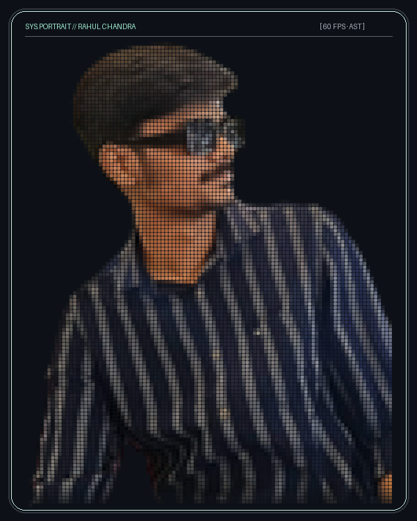
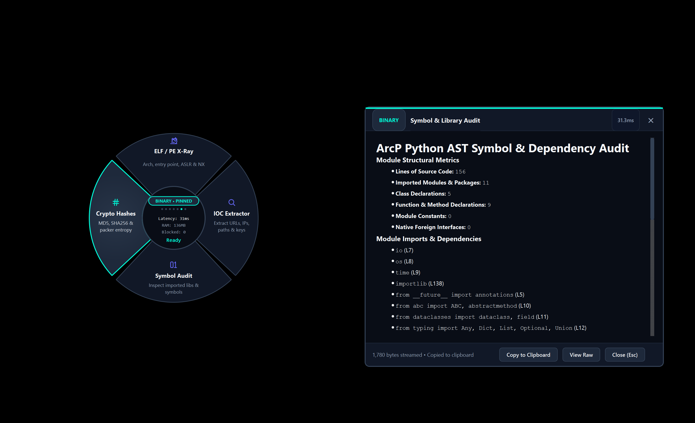
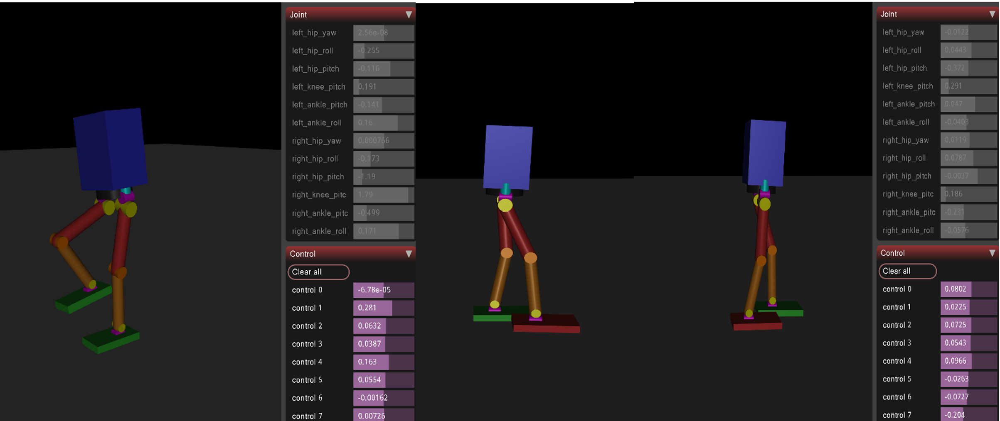
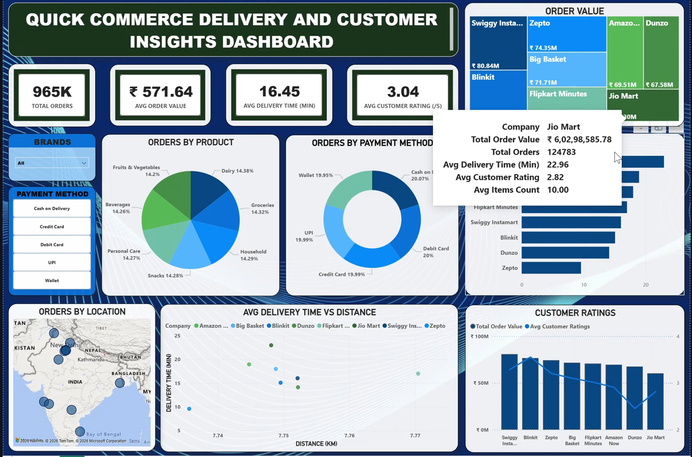
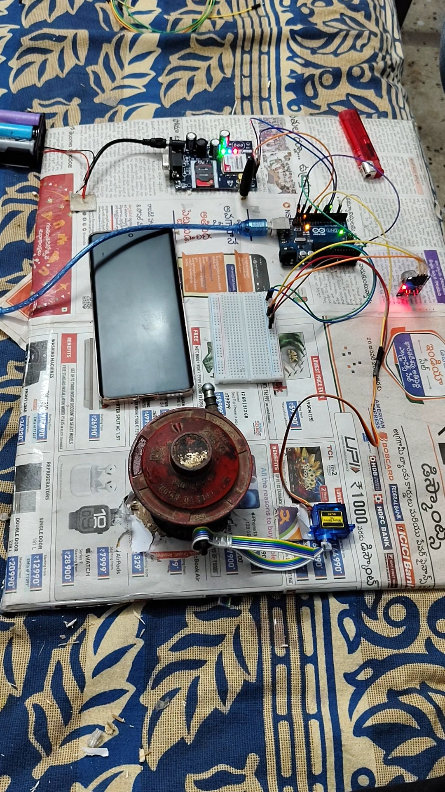

<div align="center">

<!-- Hero Header Card with Pixel Art Portrait -->
<a href="https://rahulchandra.vercel.app">
  
</a>

# ⚡ Rahul Chandra Padamuttam
### **Software Engineer · AI & Robotics · Cloud Architect**
*B.Tech in Computer Engineering @ NIAMT Ranchi · Summer Research Intern @ MANIT Bhopal*

<p align="center">
  <a href="https://readme-typing-svg.demolab.com">
    
  </a>
</p>

<!-- Quick Action Badges -->
<p align="center">
  <a href="https://rahulchandra.vercel.app">
    
  </a>
  <a href="https://www.linkedin.com/in/rahul-chandra-padamuttam-6b5888330">
    
  </a>
  <a href="mailto:rahulpc1981@gmail.com">
    
  </a>
  <a href="https://catalog-education.oracle.com/pls/certview/sharebadge?id=B6A1D0A5370B2EB9EB273914BCC136E13F9AB4858F128F572A303840CAFF7A60">
    
  </a>
  <a href="https://www.credential.net/4a181fdd-d149-4031-8ae5-31b253325631">
    
  </a>
</p>

</div>

---

### 💻 System Telemetry & Quick Diagnostics

```yaml
# system_profile.yml
entity: Rahul Chandra Padamuttam
status: Shipping High-Impact Intelligent Systems
specializations:
  - Systems & DevSecOps: [AST Parsers, Zero-Disk Ephemeral Validation, High-Throughput Pipelines]
  - Robotics & Hardware: [12-DOF Kinematics, Bipedal CPG/FSM Locomotion, Microcontrollers]
  - Cloud & Observability: [Oracle Cloud (OCI), SigNoz, OpenTelemetry, Docker, CI/CD]
  - AI & Computer Vision: [CNN/RNN Benchmarks, DeepFace, Gemini Multimodal Agents]
current_focus:
  - Building ArcP (Autonomous Radial Context Pipeline)
  - Researching Adaptive Locomotion Controllers for Humanoids
credentials:
  - Oracle Cloud Infrastructure Certified Foundations Associate
  - Google Gemini Certified University Student
  - Microsoft Elevate AICTE (Power BI & Azure Analytics)
```

---

## 🚀 Flagship Projects

<table width="100%">
  <tr>
    <td width="50%" valign="top">
      <h3 align="center">🛡️ ArcP — Autonomous Radial Context Pipeline</h3>
      <div align="center">
        <a href="https://github.com/rahulchandra2004/ArcP">
          
        </a>
      </div>
      <p><b>Flagship Ongoing DevSecOps Pipeline & Desktop Firewall</b></p>
      <p>A 60-FPS frameless polymorphic radial desktop firewall, Edge-AI PII sanitizer, and zero-disk DevSecOps pipeline with hardware-accelerated AST parsing, ephemeral verification, and sub-millisecond telemetry.</p>
      <p>
        <code>DevSecOps</code> <code>Zero-Disk</code> <code>Edge AI</code> <code>PII Sanitizer</code> <code>C++ / Rust</code> <code>AST Parsing</code>
      </p>
      <div align="center">
        <a href="https://github.com/rahulchandra2004/ArcP">
          
        </a>
        
      </div>
    </td>
    <td width="50%" valign="top">
      <h3 align="center">🤖 12 DOF Bipedal Humanoid Robot</h3>
      <div align="center">
        <a href="https://github.com/rahulchandra2004">
          
        </a>
      </div>
      <p><b>Autonomous Locomotion & Kinematic Gait Research</b></p>
      <p>Spearheaded at MANIT Bhopal: Developed dynamic kinematic walking gaits and real-time posture stabilization using Finite State Machines (FSM) and Central Pattern Generators (CPG) across 12 degrees of freedom.</p>
      <p>
        <code>Robotics</code> <code>Kinematics</code> <code>FSM</code> <code>CPG</code> <code>Embedded C++</code> <code>NIT Bhopal</code>
      </p>
      <div align="center">
        <a href="https://github.com/rahulchandra2004">
          
        </a>
        
      </div>
    </td>
  </tr>
  <tr>
    <td width="50%" valign="top">
      <h3 align="center">🔍 OmniSRE — Autonomous AI Observability</h3>
      <p><b>Winner · WeMakeDevs × SigNoz Global Hackathon</b></p>
      <p>Engineered a closed-loop AI observability and autonomous self-healing platform. Leveraged OpenTelemetry and SigNoz to trace multi-agent LLM workflows, isolate telemetry regressions, and trigger automated self-remediation.</p>
      <p>
        <code>AI Agents</code> <code>SigNoz</code> <code>OpenTelemetry</code> <code>Observability</code> <code>Python</code> <code>Self-Healing</code>
      </p>
      <div align="center">
        <a href="https://github.com/rahulchandra2004/omnisre-signoz-hackathon">
          
        </a>
        <a href="https://dev.to/rahulchandra2004/omnisre-closed-loop-ai-observability-and-autonomous-self-healing-1lf4">
          
        </a>
        
      </div>
    </td>
    <td width="50%" valign="top">
      <h3 align="center">📊 UIDAI Data Hackathon 2026</h3>
      <p><b>National Challenge · Govt of India & data.gov.in</b></p>
      <p>Built an end-to-end data engineering pipeline processing nation-scale Aadhaar lifecycle records. Formulated demographic anomaly detection algorithms and statistical consistency models with interactive visual reporting.</p>
      <p>
        <code>Python</code> <code>Data Engineering</code> <code>Anomaly Detection</code> <code>Pandas</code> <code>UIDAI</code> <code>data.gov.in</code>
      </p>
      <div align="center">
        <a href="https://github.com/rahulchandra2004/UIDAI-Data-Hackathon-2026">
          
        </a>
        
      </div>
    </td>
  </tr>
  <tr>
    <td width="50%" valign="top">
      <h3 align="center">📈 Quick Commerce Intelligence Dashboard</h3>
      <div align="center">
        <a href="https://github.com/rahulchandra2004/Quick-Commerce-Dashboard">
          
        </a>
      </div>
      <p><b>Microsoft Elevate AICTE · Enterprise Power BI</b></p>
      <p>Operational analytics platform tracking order volume, delivery SLA benchmarks, revenue, and gross merchandise value (GMV) across instant delivery networks like Swiggy Instamart and Blinkit.</p>
      <p>
        <code>Power BI</code> <code>DAX</code> <code>Data Modeling</code> <code>Swiggy</code> <code>Blinkit</code> <code>Analytics</code>
      </p>
      <div align="center">
        <a href="https://github.com/rahulchandra2004/Quick-Commerce-Dashboard">
          
        </a>
      </div>
    </td>
    <td width="50%" valign="top">
      <h3 align="center">🚨 IoT Gas Leakage Alert System</h3>
      <div align="center">
        <a href="https://github.com/rahulchandra2004/gas-leakage-detection-system">
          
        </a>
      </div>
      <p><b>Safety-Critical Environmental Hardware Monitor</b></p>
      <p>Real-time gas monitoring system built with C++, Arduino microcontroller, and GSM telemetry. Automatically broadcasts emergency SMS notices and triggers audible alerts upon concentration threshold breach.</p>
      <p>
        <code>Embedded C++</code> <code>Arduino</code> <code>GSM Telemetry</code> <code>Hardware Sensors</code> <code>IoT</code>
      </p>
      <div align="center">
        <a href="https://github.com/rahulchandra2004/gas-leakage-detection-system">
          
        </a>
      </div>
    </td>
  </tr>
</table>

---

## 🛠️ Technical Arsenal

<div align="center">

### Languages & Core Systems
<p>
  
  
  
  
  
  
</p>

### AI, Computer Vision & Deep Learning
<p>
  
  
  
  
  
  
</p>

### Cloud, Observability & DevSecOps
<p>
  
  
  
  
  
  
</p>

### Robotics, Embedded & IoT
<p>
  
  
  
  
  
</p>

### Data Science & Analytics
<p>
  
  
  
  
  
</p>

</div>

---

## 💼 Experience & Research Timeline

```
┌────────────────────────────────────────────────────────────────────────────────────────┐
│  EXPERIENCE RECORD                                                                     │
├──────────────────────────┬─────────────────────────────────────┬───────────────────────┤
│  Role                    │ Organization                        │ Duration / Status     │
├──────────────────────────┼─────────────────────────────────────┼───────────────────────┤
│  Core Member & Lead      │ Code/Forge, NIAMT Ranchi            │ Jan 2026 – Present    │
│  Research Intern         │ MANIT Bhopal (NIT Bhopal)           │ Jun 2026 – Jul 2026   │
│  Machine Learning Intern │ EISystems Technologies              │ Feb 2026 – Apr 2026   │
│  Power BI Intern         │ Microsoft Elevate AICTE Internship  │ Feb 2026 – Mar 2026   │
│  Artificial Intel. Intern│ Codec Technologies India            │ Jan 2026              │
│  Python Intern           │ YBI Foundation                      │ Dec 2025 – Jan 2026   │
└──────────────────────────┴─────────────────────────────────────┴───────────────────────┘
```

- **Core Member @ Code/Forge, NIAMT Ranchi** *(Jan 2026 – Present)*
  - Leading the robotics and automation student community, organizing hands-on embedded systems bootcamps, hackathons, and collaborative engineering projects.
- **Research Intern @ MANIT Bhopal (NIT Bhopal)** *(Jun 2026 – Jul 2026)*
  - Selected for the prestigious Summer Internship Programme at NIT Bhopal. Formulated mathematical kinematic locomotion models and bio-inspired CPG/FSM controllers for an autonomous 12-DOF bipedal robot.
- **Machine Learning Intern @ EISystems Technologies** *(Feb 2026 – Apr 2026)*
  - Benchmarked deep neural architectures (CNN, DNN, RNN) on image classification datasets, optimizing inference latency, precision, and weight quantization.
- **Power BI Intern @ Microsoft Elevate AICTE** *(Feb 2026 – Mar 2026)*
  - Designed interactive multi-metric analytical dashboards evaluating delivery SLAs, operational throughput, and GMV dynamics for instant-commerce platforms.
- **AI Intern @ Codec Technologies India** *(Jan 2026)*
  - Engineered predictive regressors and built real-time acoustic speech-to-text pipelines integrating CMU Sphinx and Google Speech API.
- **Python Programming Intern @ YBI Foundation** *(Dec 2025 – Jan 2026)*
  - Implemented artificial neural network (ANN) architectures for temporal load and energy forecasting using TensorFlow.

---

## 🏆 Hackathons & Competitions

| Event | Organization | Project | Recognition |
| :--- | :--- | :--- | :--- |
| **Agents of SigNoz** | WeMakeDevs × SigNoz | **OmniSRE** | 🥇 **Global Winner** · Closed-loop AI Observability & Self-Healing |
| **UIDAI Data Hackathon 2026** | Govt of India · UIDAI · data.gov.in | **Aadhaar Data Pipeline** | 🇮🇳 **National Contender** · Nation-Scale Demographic Anomaly Detection |

---

## 📜 Verified Industry Certifications

- **Oracle Cloud Infrastructure Certified Foundations Associate** · *Oracle*  
  [Verify Credential](https://catalog-education.oracle.com/pls/certview/sharebadge?id=B6A1D0A5370B2EB9EB273914BCC136E13F9AB4858F128F572A303840CAFF7A60)
- **Gemini Certified University Student** · *Google for Education*  
  [Verify Credential](https://www.credential.net/4a181fdd-d149-4031-8ae5-31b253325631)
- **Microsoft Elevate AICTE** · *Power BI, AI & Machine Learning, Azure*
- **TCS iON Career Edge** · *Young Professional Program (Tata Consultancy Services)*
- **Cybersecurity Job Simulation** · *Deloitte*
- **AI Fundamentals** · *Cisco & IBM SkillsBuild*
- **AI Upskilling Program** · *Qualcomm Academy*
- **Data Science Certification** · *HP LIFE*

---

## 📊 Live GitHub Metrics

<div align="center">

<table border="0">
  <tr>
    <td>
      <a href="https://github.com/rahulchandra2004">
        
      </a>
    </td>
    <td>
      <a href="https://github.com/rahulchandra2004">
        
      </a>
    </td>
  </tr>
  <tr>
    <td colspan="2" align="center">
      <a href="https://github.com/rahulchandra2004">
        
      </a>
    </td>
  </tr>
</table>

</div>

---

## 🤝 Let's Connect & Collaborate

I am always keen to discuss systems engineering, AI observability, robotics kinematics, and cloud architecture.

<div align="center">

<a href="https://rahulchandra.vercel.app">
  
</a>
&nbsp;
<a href="https://www.linkedin.com/in/rahul-chandra-padamuttam-6b5888330">
  
</a>
&nbsp;
<a href="mailto:rahulpc1981@gmail.com">
  
</a>

<br/><br/>

```
"Building rock-solid, scalable, and visually stunning digital experiences at the intersection of AI, Robotics, and Cloud."
```

<sub>Crafted with precision · © Rahul Chandra Padamuttam</sub>

</div>
